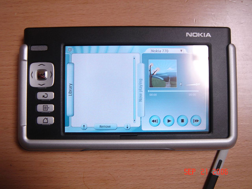
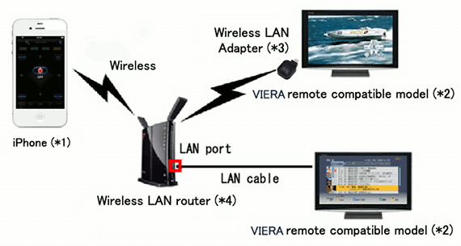
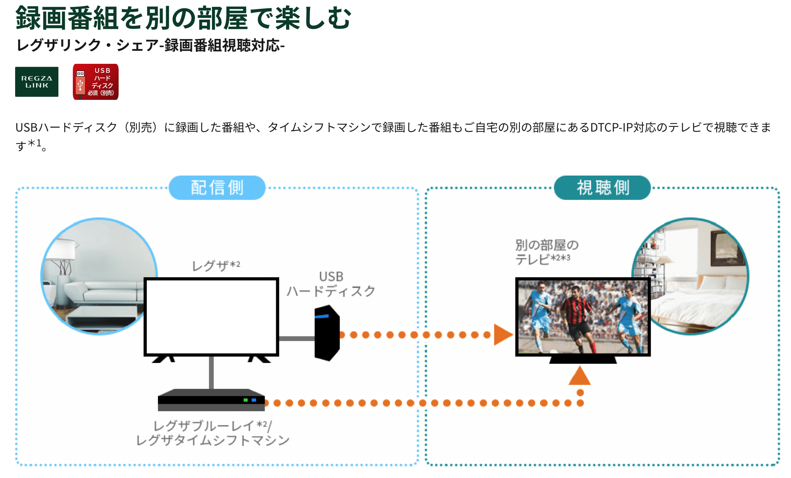

# mUPnP for C


[](https://github.com/cybergarage/mupnp/actions/workflows/make.yml)
[](http://cybergarage.github.io/mupnp/)
[](https://codecov.io/gh/cybergarage/mupnp)

mUPnP for C is a development package for UPnP™ [^1] (Universal Plug and Play) developers. It provides a set of APIs to create UPnP™ devices and control points quickly and easily. This README provides an overview of the package and its contents, along with setup and usage instructions.

The UPnP™ architecture is designed to enable the discovery and control of networked devices and services, such as media servers and players, within a home network. UPnP™ is based on several standard protocols, including GENA, SSDP, SOAP, HTTPU, and HTTP. To create UPnP™ devices, you need to understand and implement these protocols.


mUPnP for C simplifies this process by handling these protocols automatically. It allows developers to focus on creating their devices and control points without worrying about the underlying protocol details.

mUPnP for C runs on Unix-like systems, macOS, iOS, and Windows. Since version 3.1.0, it also runs on **ESP32 microcontrollers as an ESP-IDF component**.

**mUPnP for C** is supported by IPA, INFORMATION-TECHNOLOGY PROMOTION AGENCY, JAPAN, as part of [Mitoh Program 2004](https://www.ipa.go.jp/archive/jinzai/mitou/mitoipedia/2004shimoki-seika.html#sakamura).

## Building the Library and Samples

The following sections describe how to build or install the library and samples on each platform.

### Unix

mUPnP for C is distributed as an Automake project. For a Git checkout, install Autoconf, Automake, and the Autoconf Archive macros before building:

```
cd mupnp
./bootstrap
./configure
make
```

Run `./bootstrap` for the first Git build and after changes to build definitions
or source/header file lists, then rerun `./configure`. Ordinary edits to existing
source files only need `make`. Prepared `make dist` release tarballs can start at
`./configure`; GitHub-generated source archives follow the Git checkout steps.

### Homebrew (macOS, Linux)

On platforms that support [Homebrew](https://brew.sh/), install mUPnP with the following commands:

```
brew tap cybergarage/homebrew
brew install mupnp
```

### macOS

An Objective-C wrapper is available for Cocoa on macOS. The framework currently supports only basic control point functionality. Use the C library if you need the full functionality of mUPnP for C.

The bundled Xcode projects build with Xcode 27 and target macOS 12.0 or later and iOS 15.0 or later.

### ESP32 (ESP-IDF)

The repository can be used directly as an ESP-IDF component with Espressif's
managed Expat dependency. The port targets **ESP32 with one active Wi-Fi station
interface and IPv4**; the build baseline is ESP-IDF v5.5.5 (`>=5.5,<6.0`).

To try the Wi-Fi control-point example:

```
cd mupnp/examples/espidf/control_point
idf.py set-target esp32
idf.py menuconfig   # mUPnP control point example -> Wi-Fi SSID/password
idf.py build
idf.py -p /dev/ttyUSB0 flash monitor
```

To use mUPnP in your own application, place this repository at
`<project>/components/mupnp` (for example, as a Git submodule pinned to the
`3.1.4` tag), add `REQUIRES mupnp` to your component, and include
`<mupnp/upnp.h>`.

Limited hardware testing of the control point on an ESP32 DevKitC-VE has been reported.
Device hosting, other ESP32-family targets, IPv6, Ethernet, and long-duration
operation have not been validated yet. See the [ESP-IDF guide](doc/espidf.md)
for required `sdkconfig` settings, notes on lifetime and memory, and a hardware
validation checklist.

### Windows

mUPnP includes Visual Studio 2005 projects for Windows in the `mupnp/*/win32/vs2005` directories. No platform projects are provided for Windows CE, but a contributor has verified that the source code compiles successfully.

## References

### mUPnP for C

For information on developing UPnP devices or control point applications with **mUPnP for C**, see the following developer documentation:

* [Programming Guide for C](http://cybergarage.github.io/mupnp/)
* [Doxygen](http://cybergarage.github.io/mupnp/)

### mUPnP for Objective-C

**mUPnP for C** includes an Objective-C wrapper for iOS and macOS. For details, see the following developer documentation:

* [Programming Guide for Objective-C](http://cybergarage.github.io/mupnp/objc/html/)
* [Doxygen](http://cybergarage.github.io/mupnp/objc/html/)

## Examples

- UPnP control point examples
  - UPnP controller for UPnP devices
    - [UPnP multicast dump utility](https://github.com/cybergarage/mupnp/tree/master/examples/upnpdump)
  - UPnP controller for standard UPnP devices
    - [UPnP Internet gateway utility](https://github.com/cybergarage/mupnp/tree/master/examples/upnpigddump)
    - [UPnP/AV media server utility](https://github.com/cybergarage/mupnp/tree/master/examples/upnpavdump)
  - Embedded control point
    - [ESP32 Wi-Fi control point (ESP-IDF)](https://github.com/cybergarage/mupnp/tree/master/examples/espidf/control_point)

- UPnP device examples
  - UPnP standard devices
    - [UPnP BinaryLight:1 device](https://github.com/cybergarage/mupnp/tree/master/examples/binarylight)
  - UPnP non-standard devices
    - [UPnP clock device](https://github.com/cybergarage/mupnp/tree/master/examples/clock)

## Adoption in Consumer Products

**mUPnP for C** is used in a variety of consumer products. The following is a non-exhaustive list of notable implementations.

### Nokia 770 Internet Tablet

Nokia engineers helped improve the initial **mUPnP for C** release. Nokia developed the UPnP/AV Control Point application, **Media Streamer**, for the Nokia 770 Internet Tablet. The application is based on **mUPnP for C**, with custom patches from Nokia.



### Panasonic VIERA Remote for iOS Devices
The [**VIERA Remote**](http://panasonic.jp/support/global/cs/tv/vremote/index.html) is a TV remote control app for Panasonic VIERA TVs (plasma and LCD models). It allows users to control channels, switch inputs, and adjust the volume directly from an **iPhone, iPod touch, or iPad** (iOS 4.2 or later). **mUPnP for C** functions as the UPnP framework for this app.



### Toshiba REGZA Televisions

[**REGZA**](https://www.regza.com/) is Toshiba’s former AV equipment brand. **mUPnP for C** is embedded in REGZA televisions, enabling seamless media streaming and connectivity.



[^1]: UPnP™ is a certification mark of the UPnP™ Implementers Corporation.
