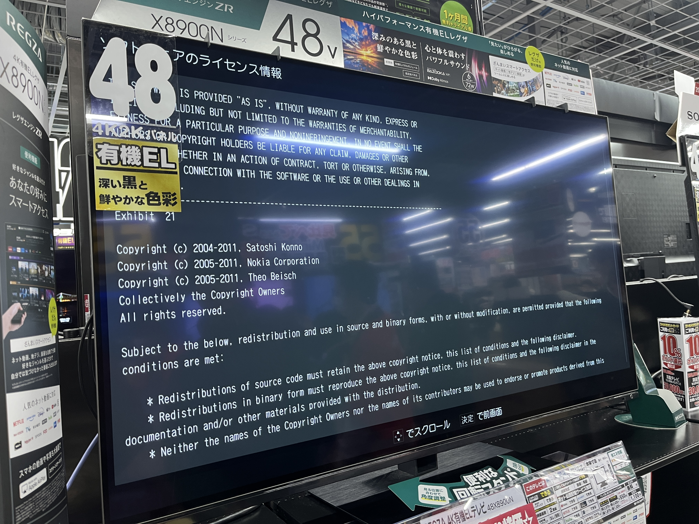

# Adoption evidence

Sources rechecked: **2026-10-22**. All PDF page numbers below are **1-based,
counted from the beginning of the PDF**, including covers, rather than inferred
printed page numbers. Accessible sources were read, not just search snippets.

**mUPnP for C (formerly CyberLink for C)** is one continuous project. The
[ChangeLog](../ChangeLog) records its rename in 3.0.0 on 2015-09-02; historical
**CyberLink for C** and **clinkc** references are part of its adoption history.
The names and versions below reproduce the evidence rather than dividing that
history into separate projects. A source naming 2.x does not establish use of
the latest 3.x release. No partnership, endorsement, sales volume or particular
implementation role is inferred.

## Nokia 770 — Media Streamer

The existing project README reports Nokia's Media Streamer app for the Nokia 770
using this library with Nokia patches. This concerns the app, not factory
installation on every Nokia 770.

- [CyberGarage: Nokia 770](https://www.cybergarage.org/awards/nokia770/): project-authored account.
- [Maemo developers mailing-list message, 2006-11-02](https://lists.maemo.org/pipermail/maemo-developers/2006-November/006019.html):
  a user reports the required **clinkc** while installing Media Streamer. No
  component version is established by that message.
- [Vulnerability Analysis and Protection Schemes of Universal Plug and Play Protocol](https://www.researchgate.net/publication/220775334_Vulnerability_Analysis_and_Protection_Schemes_of_Universal_Plug_and_Play_Protocol),
  section **II.C, Cyberlink**: secondary discussion. It cites CyberGarage and is
  not independent manufacturer confirmation.

## Panasonic

- Product: **Panasonic Blu-ray Remote 2011 (Remote 2011)** app.
- Sources: [Enjoy your Blu-ray Disc Player with Remote 2011](https://av.jpn.support.panasonic.com/support/global/cs/bd/bremote/),
  which directly links its [Licensed Application End User License Agreement](https://av.jpn.support.panasonic.com/support/global/cs/bd/bremote/agreement.html).
- EULA section **j** names **CyberLink for C** and the three copyright holders;
  no component version is given. The product page identifies the app and its
  compatible players; it does not establish library embedding in those players.
- The Japanese [ライセンスアプリケーション・エンドユーザ使用許諾契約](https://av.jpn.support.panasonic.com/support/bd_agreement.html),
  section **j**, also names CyberLink for C without a version. Its text describes
  a remote-controller app but does not itself give a specific app name.
  Neither EULA is used here as VIERA Remote-specific evidence.

## Toshiba / REGZA televisions

The existing project README reports use in REGZA televisions. No manufacturer
Web document directly naming CyberLink for C or mUPnP was verified in this review.
No model-wide, current-version or implementation-purpose claim is made.

User-provided photograph, inspected on **2026-10-22** and reproduced with the
user's permission. Store signage reads **X8900N / 48V** and the price label reads
**48X8900N**. The television's software-license screen shows **Exhibit 21** and
copyright notices for Satoshi Konno (**2004–2011**), Nokia Corporation
(**2005–2011**) and Theo Beisch (**2005–2011**). The photograph does **not** show
a component name or version, establish its capture date or model year, or prove
use throughout the REGZA range. It supplements the project report as
copyright-only evidence; it is not a manufacturer Web disclosure.

## TCL

- Products: **50CF630K / 55CF630K**, UK manual.
- Source: [TCL Important information and manual](https://www.tcl.com/content/dam/brandsite/europe-documents/tv/um/cf630k/TCL_D6100_UK_50_55CF630K.pdf), PDF page **6**.
- The product notice explicitly identifies **CyberLink for C**. No component
  version is stated; the claim is limited to the models covered by this manual.

## NEC Aterm

- Products: WG2600HP, WG2600HP2 and WG2600HP3.
- Sources: official user manuals, “本商品で使用しているソフトウェアライセンスについて”:
  [WG2600HP](https://www.aterm.jp/function/wg2600hp/appendix/license.html),
  [WG2600HP2](https://www.aterm.jp/function/wg2600hp2/appendix/license.html),
  [WG2600HP3](https://www.aterm.jp/function/wg2600hp3/appendix/license.html).
- Each names **CyberLink for C v2.0**, with copyright notices for Satoshi Konno,
  Nokia Corporation and Theo Beisch. This confirms those models' license listings.

## iFFALCON

- Products: **U75A / U85A series**.
- Source: [U75A / U85A User Manual](https://www.iffalcon.com/content/dam/brandsite/region/turkey/user-manual/tv/%E9%9B%B7%E9%B8%9FJ0101-003566%20U75A%20U85A%20TR.pdf), PDF page **5**, “OSS Notice”.
- The notice names **CyberLink for C** as used by the product. No component
  version is stated. This is the manual hosted on the Turkish regional site.

## Zyxel

The official *Firmware Release Note* documents list **clinkc**, version **2.4**,
with status **Modified**, under “Public Domain Software Announcements”. Their
covers and Supported Platforms sections define the following firmware scope:

| Supported models | Firmware | Source / PDF page |
| --- | --- | --- |
| EX5600-T0, EX5601-T0, EX5600-T1, EX5601-T1 | V5.70(ACDZ.3.8)C0 | [Release note](https://spdl.zyxel.com/EX5601-T1/firmware%28public_version%29/EX5601-T1_5.70%28ACDZ.3.8%29C0.pdf), page 6 |
| EX3600-T0 | V5.70(ACIF.3)C0 | [Release note](https://spdl.zyxel.com/EX3600-T0/firmware%28public_version%29/EX3600-T0_5.70%28ACIF.3%29C0.pdf), page 6 |
| DX3301-T0, EX3301-T0, DX3300-T0, EX3300-T0, EX3200-T0, DX3300-T1, EX3300-T1 | V5.50(ABVY.6.4)C0 | [Release note](https://spdl.zyxel.com/DX3300-T0/firmware%28public_version%29/DX3300-T0_5.50%28ABVY.6.4%29C0.pdf), page 8 |

These are shared firmware listings, not a count of independent adoption projects.
The documents do not establish use in every firmware version or Zyxel product.

## Audio Group Denmark

- Product: **Aavik Stream app**.
- Source: [Privacy Policy – App](https://audiogroupdenmark.com/privacy-policy-app/),
  “Open Source Licenses”.
- Names **CyberLink for C**, Satoshi Konno, Nokia Corporation and Theo Beisch,
  and the historical CyberGarage project URL. No component version is stated.
  This is an app disclosure, not evidence for all Aavik hardware.

## llink

- Project: **llink media server**, an open-source project.
- Source: [Project README](https://github.com/lundman/llink/blob/main/README.md),
  “Building llink for macOS from source”.
- Build instructions identify **clinkc-2.4**, **clinkcav-trunk**, enable clinkc in
  the llink configuration, and list **libclinkcav.0.dylib** for app bundling.
  This establishes the documented build integration, not every distributed build.

## Copyright-only evidence and investigation candidates

The following notices have lower specificity than the named-component entries.
Copyright holders alone do not establish the component name or version.

- **TEAC WS-A70** — [WS-A70 Owner's Manual](https://teac.jp/downloads/products/teac/ws-a70/WS-A70_OM_E_vA4.pdf),
  PDF page **40**: **libupnp.so**, Satoshi Konno and Nokia Corporation; the license
  text refers to Cyber Garage. It does not explicitly name CyberLink for C or a
  version. Do not identify it with another libupnp implementation by filename alone.
- **Panasonic Stereo Remote** — [official license agreement](https://av.jpn.support.panasonic.com/support/audio/stereo_remote/2012/agreement.html),
  sections **i and j**: Satoshi Konno, Nokia and Theo Beisch; no component
  name or version is established.
- **Panasonic Android photo-editing application for DIGA** — [Android photo-editing software license agreement](https://av.jpn.support.panasonic.com/support/bd/diga_album_maker/app/android/agreement.html),
  section **7**: the same three holders. The exact marketed app name
  and component name/version are not established by this notice, so it is not a
  named-component adoption entry.
- **ConversDigital mconnect series** — [Terms of Use](https://www.conversdigital.com/termsofuse.html):
  returned **HTTP 403** on 2026-10-22. Prior search leads mentioning mconnect
  Player / Lite / HD and Control / Control HD remain **unverified**; the body was
  not read and no adoption claim is added from snippets.

## Exclusions

FINAL FANTASY Type-0 HD (CyberLink for C++) and Geniatech Netstream4X
(CyberLink4Java) concern other language implementations and are excluded.
MiniUPnP and unrelated CyberLink-company products are also outside this C-library list.
